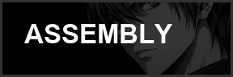
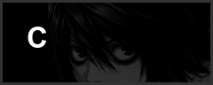
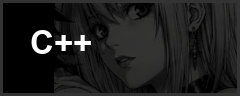
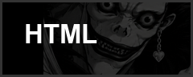
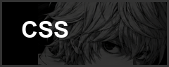
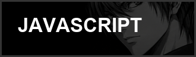
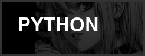
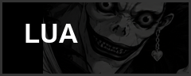
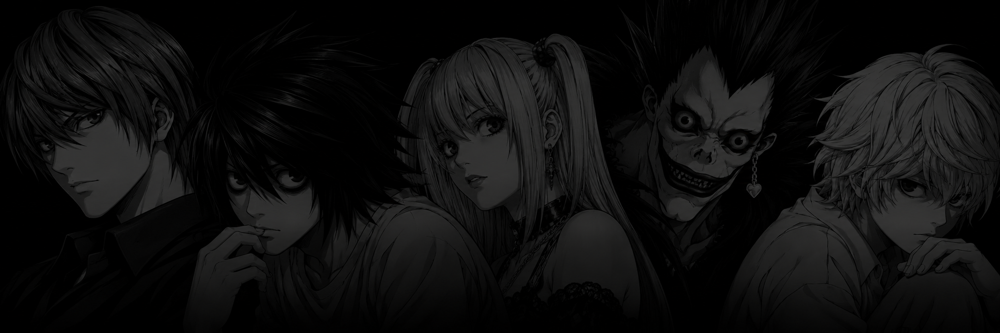

<h1 align="center">komzy</h1>

  

  <strong>Full-stack developer · Italy</strong> 
  Reverse engineering &amp; tooling

<code>OPEN FOR HIRE</code>

## Experience

| Where | What I did |
| :--- | :--- |
| **Presezzi Extrusion S.p.A.** Lead developer · Current | **Smart Machinery Center** Full-stack software, from my initial idea through design, frontend, and backend. Also working as a Smart Machinery Analyst. |
| **[Archicercle](https://archicercle.es)** Erasmus placement · Valencia, Spain | **Website rebuild** Rebuilt the entire website from scratch. |

## Stack

| | |
| :--- | :--- |
| **Main** |    |
| **Web** |     |
| **Scripting** |   |

---

